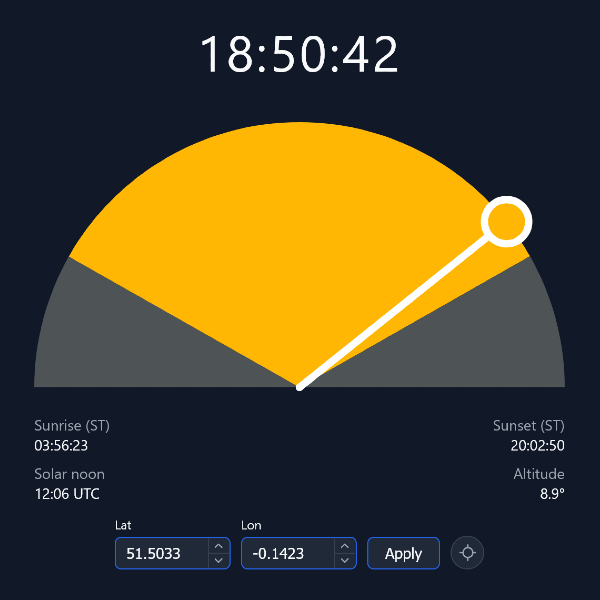

# local-solar-time

<p align="center">
  
</p>

A Go service that streams apparent (true) solar time, Sun position, and rise/set events over WebSocket for any latitude/longitude, computed continuously from the server's own NTP-disciplined clock. Ships with a Vite + React + TypeScript web frontend, served by the same Go binary, that visualizes solar time on an SVG half-circle clock, with browser geolocation, manual coordinate input, and automatic reconnection.

## Prerequisites

- Docker with the Compose plugin
- An NTP-synchronized host clock - solar time accuracy depends entirely on it
- Go 1.27+ - only needed for local backend builds outside Docker
- Node.js 20+ and npm - only needed for local frontend builds outside Docker

## Quick start

```sh
git clone <repo-url>
cd local-solar-time
make docker-up   # builds the image and starts the service
```

Open `http://localhost:8080` for the web UI, or connect a headless client directly to the WebSocket endpoint (see [Backend](#backend)).

## Frontend

A Vite + React + TypeScript single-page app. In the Docker image the Go binary serves the built files from `SOLAR_STATIC_DIR` alongside `/ws`, falling back to `index.html` for unknown paths.

- Connects immediately with the default location (Copenhagen, `lat: 55.6761, lon: 12.5683`) so the clock is visible before any geolocation prompt.
- Requests browser geolocation in the background; on grant, transitions to the real location with a ~0.4s tween.
- Manual lat/lon inputs with inline validation let you override the location at any time.
- Reconnects automatically with exponential backoff (1s initial, 30s cap) on connection loss.

## Backend

### WebSocket API

Connect to `ws://<host>:<port>/ws`, then send a subscribe message once with your location:

```json
{ "lat": 55.6761, "lon": 12.5683 }
```

The server then streams JSON updates at the configured cadence:

```json
{
  "solar_time": "12:34:56",
  "equation_of_time_minutes": -3.2,
  "utc_offset_seconds": -192,
  "altitude_deg": 42.1,
  "azimuth_deg": 195.3,
  "solar_noon": {
    "solar_time": "12:00:00",
    "utc": "2026-06-14T10:23:00Z"
  },
  "today": {
    "sunrise": { "solar_time": "04:51:00", "utc": "2026-06-14T02:54:00Z" },
    "sunset":  { "solar_time": "19:09:00", "utc": "2026-06-14T17:12:00Z" }
  },
  "previous_sunrise": { "solar_time": "04:51:00", "utc": "2026-06-13T02:54:00Z" },
  "next_sunrise":     { "solar_time": "04:51:00", "utc": "2026-06-14T02:54:00Z" },
  "previous_sunset":  { "solar_time": "19:09:00", "utc": "2026-06-13T17:12:00Z" },
  "next_sunset":      { "solar_time": "19:09:00", "utc": "2026-06-14T17:12:00Z" }
}
```

Above latitude ~89.4°, `solar_time`, `azimuth_deg`, `solar_noon`, `today`, and the four `*_sunrise`/`*_sunset` fields are `null`, and a `polar_cap` object with a `reason` string is added instead. During polar day or polar night at lower latitudes, `today.sunrise`/`today.sunset` are `null` but the bracketing `previous_sunrise`/`next_sunrise`/`previous_sunset`/`next_sunset` fields are omitted entirely.

Invalid coordinates (e.g. `lat` outside ±90) get `{ "error": "..." }` instead of an update, and the connection stays open for another subscribe attempt.

### Configuration

| Variable | Flag | Default | Description |
|---|---|---|---|
| `SOLAR_PORT` | `--port` | `8080` | HTTP listen port for `/ws` and the frontend |
| `SOLAR_CADENCE` | `--cadence` | `1s` | Update push interval (e.g. `1s`, `500ms`) |
| `SOLAR_STATIC_DIR` | `--static-dir` | empty | Directory of built frontend files to serve. Empty serves only `/ws`. The Docker image sets it to `/static` |

Precedence is flag > environment variable > default. Copy `.env.example` to `.env` to override locally.

The process logs structured JSON to stdout (via `zerolog`) and shuts down gracefully on `SIGINT`/`SIGTERM`, closing in-flight WebSocket connections before exiting.

## Development

Docker runs the production image: one container serving both `/ws` and the frontend. For day-to-day work, run the backend binary and the Vite dev server locally instead (see below).

### Docker

```sh
make docker-build   # build the image
make docker-up      # start the service (add -d to detach)
make docker-down    # stop and remove containers
```

Open `http://localhost:8080` (or your `SOLAR_PORT`) for the web UI. Code changes require `make docker-build && make docker-up` to take effect.

### Backend

```sh
make build   # compile the local binary to ./local-solar-time
make test    # Go package tests
make lint    # Go linting (golangci-lint)
make fmt     # format with goimports
```

Run it directly with `./local-solar-time` (reads `.env` in the repo root, see [Configuration](#configuration)). Without `SOLAR_STATIC_DIR` it serves only `/ws`, leaving the frontend to Vite.

### Frontend

Run from `web/`:

```sh
npm install      # install dependencies (first time, or after package.json changes)
npm run dev       # Vite dev server on http://localhost:5173 - proxies /ws to the backend
npm run build     # TypeScript type-check + Vite production build
npm run lint      # ESLint - includes react-compiler/react-compiler rule
```

The dev server proxies `/ws` to `localhost:8080`, or to `SOLAR_PORT` from `.env` in the repo root if set. No `.env` is needed. Start the backend first with `make build && ./local-solar-time`. No automated frontend tests exist; correctness is verified by `npm run build` (TypeScript) and the manual smoke test checklist in the project documentation.

## License

Licensed under the [PolyForm Noncommercial License 1.0.0](LICENSE). Noncommercial use is free; commercial use requires a separate agreement.
